## Modular.py:

- Đây là file thuật toán số học modulo, là nền tảng toán học của mật mã, gồm các hàm:

### 1. Số học modulo:

- normalize_mod(a, m): Chuẩn hóa số về khoảng 0 đến m-1
- add_mod(a, b, m): Cộng modulo
- subtract_mod(a, b, m): Trừ modulo
- multiply_mod(a, b, m): Nhân modulo

### 2. Thuật toán Euclid:

- gcd(a, b): Tìm ước chung lớn nhất
- extended_gcd(a, b): Tìm gcd và 2 hệ số Bezout
- is_coprime(a, b): Kiểm tra nguyên tố cùng nhau

### 3. Nghịch đảo nhân modulo: mod_inverse(a, m)

### 4. Zn và Zn\*:

- zn_elements(m): Liệt kê các phần tử Zn
- zn_star(m): Liệt kê các phần tử Zn\*
- is_in_zn_star(a, m): Kiểm tra xem phần tử có ở trong Zn\* không

### Các thuật toán cần chú ý:

- Thuật toán gcd(a, b) dùng để tìm ước chung lớn nhất của 2 số nguyên a và b. Thuật toán này dựa trên thuật toán Euclid: gcd(a, b) = gcd(b, a mod b). Sơ đồ thuật toán như sau:  
  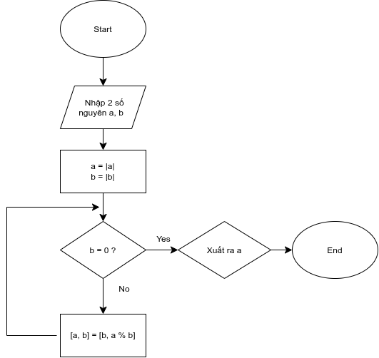

- Thuật toán Euclid mở rộng:
  - Thuật toán này dùng để tìm hệ số Bézout x, y
  - Với đầu vào là 2 số nguyên a, b, đầu ra thuật toán là (g, x, y) thỏa mãn:
    

      <strong>ax + by = g = gcd(a, b)</strong>
    

  - Sơ đồ thuật toán:  
    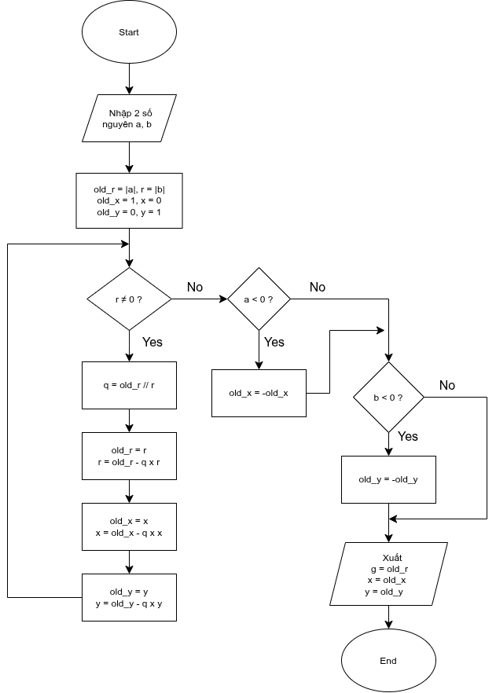
- Thuật toán tìm nghịch đảo nhân: Sử dụng thuật toán euclid mở rộng để tìm x rồi xuất ra giá trị x % m
- Thuật toán tìm Zn\*: Lặp qua từ 0 đến n rồi lấy các giá trị có gcd(a, n) = 1

======================================================================================================

## File matrix.py

- Đây là file gồm các thuật toán về ma trận, là nền tảng cho hệ mật mã dùng ma trận, có các hàm:
  - validate_matrix(): Kiểm tra ma trận hợp lệ
  - matrix_add_mod(): Cộng modulo hai ma trận
  - matrix_multiply_mod(): Nhân modulo 2 ma trận
  - determinant(): Tính định thức
  - matrix_inverse_mod(matrix, modulus): Tìm ma trận nghịch đảo modulo

### 1. validate_matrix(matrix, square: bool)

- Đây là hàm dùng để kiểm tra tính hợp lệ của ma trận, đảm bảo ma trận dầu vào của các thuật toán mã hóa là hợp lệ, tránh gây ra những lỗi không mong muốn
- Các điều kiện kiểm tra:
  - Kiểm tra cấu trúc đầu vào: đảm bảo đầu vào là cấu trúc sequence dạng [[hàng1], [hàng2]...] hoặc ((hàng1), (hàng2)...), không chấp nhận kiểu dữ liệu khác
  - Kiểm tra ma trận rỗng: Ma trận phải có ít nhất một hàng và mỗi hàng phải có ít nhất 1 phần tử
  - Kiểm tra tính đầy đủ: Tất cả hàng phải có cùng số lượng phần tử
  - Kiểm tra kiểu dữ liệu: Mỗi phần tử của ma trận phải là số nguyên, không chấp nhận kiểu dữ liệu khác như số thực, boolean
  - Kiểm tra ma trận vuông: Khi square = True, số hàng phải bằng số cột
- Cách thuật toán hoạt động:
  - Thuật toán sẽ duyệt qua từng hàng của ma trận. Số phần tử của hàng đầu tiên được dùng để làm số cột chuẩn để so sánh với các hàng sau, đảm bảo cấu trúc đầy đủ tính chữ nhật của ma trận
  - Sau khi kiểm tra toàn bộ phần tử và kích thước, thuật toán sẽ kiểm tra điều kiện ma trận vuông nếu được yêu cầu
  - Đầu ra của hàm sẽ trả về ValuError hoặc TypeError với lỗi tương ứng nếu không thỏa mãn các điều kiện. Ngược lại sẽ trả về tuple gồm (r, c) gồm số hàng và số cột của ma trận
- Lưu đồ thuật toán 
  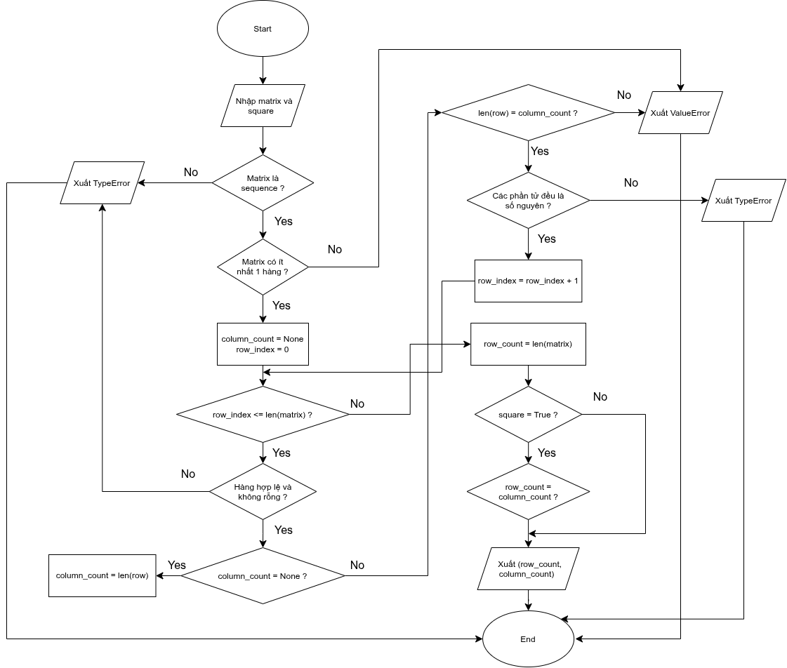

### 2. matrix_add_mod(left, right, modulus):

- Hàm matrix_add_mod dùng để thực hiện phép cộng hai ma trận có cùng kích thước theo modulo m. Kết quả của phép toán gồm các phần tử được chuẩn hóa về khoảng 0 đến m-1
- Hàm sẽ kiểm tra tính hợp lệ của ma trận trước bằng validate_matrix, rồi kiểm tra kích thước của 2 ma trận
- Nếu 2 ma trận có kích thước khác nhau thì sẽ báo lỗi
- Ngược lại, sẽ tiến hành cộng từng phần tử của 2 ma trận:
  

    <strong>Cij = (Aij + Bij) mod m</strong>
  

- Lưu đồ thuật toán:  
  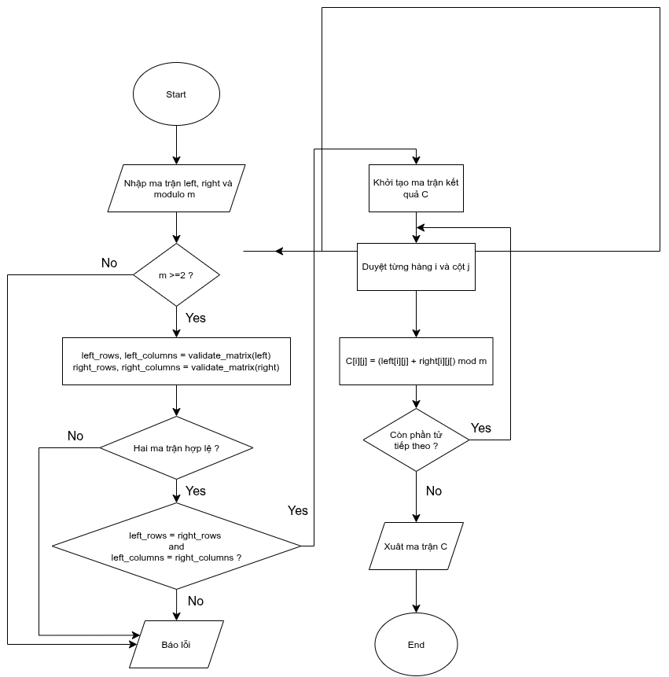

### 2. matrix_multiply_mod(left, right, modulus):

- Hàm matrix_multiply_mod dùng để nhân hai ma trận với kích thước phù hợp theo modulo m, kết quả đầu ra gồm các phần tử chuẩn hóa từ 0 đến m-1
- Lưu đồ thuật toán:
  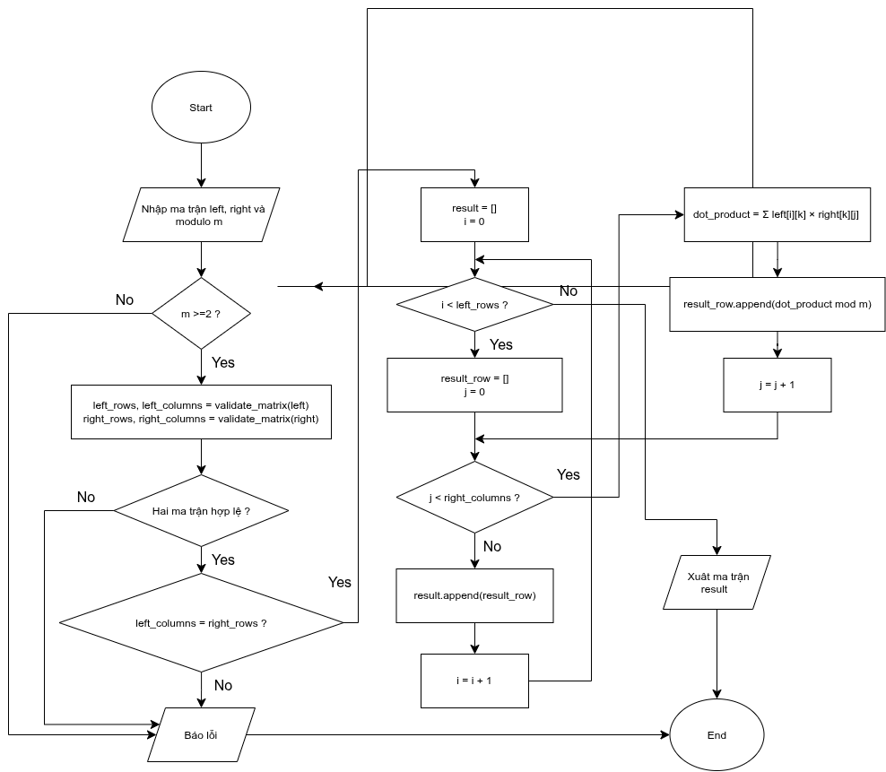

### 3. \_determinant_unchecked() và determinant():

- Hàm \_determinant_unchecked(matrix) dùng thuật toán Bareiss để tính định thức của ma trận vuông có phần tử nguyên
- Thuật toán sử dụng phương pháp khử ma trận và phép chia chính xác để hạn chế sự xuất hiện của phân số trong quá trình tính toán. Mục đích thuật toán là dùng các phép biến đổi ma trận để biến ma trận ban đầu thành ma trận tam giác trên
- Thuật toán này lựa chọn 1 phần tử pivot p = A[k][k] khác 0 lần lượt nằm trên đường chéo chính, nếu pivot đó bằng 0 thì ta sẽ phải đổi hàng, kéo theo sự thay đổi dấu của định thức
- Nếu toàn bộ các phần tử trên cột k từ hàng k trở xuống đều bằng 0 thì định thức ma trận bằng 0
- Sau khi tìm được pivot hợp lệ thì ta sẽ cập nhật các phần tử nằm phía dưới, bên phải pivot theo công thức: 
  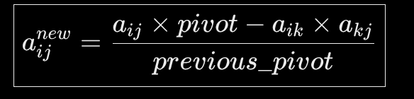
- Sau khi đã hoàn thành biến đổi ma trận ban đầu thành ma trận tam giác trên thì định thức ma trận được tính theo công thức:
  

    <strong>det(A) = (-1)^m . A'nn</strong>  
    Với m là số lần đổi hàng 
        n là kích thước ma trận vuông 
        A' là ma trận tam giác trên sau khi biến đổi 
  

- Lưu đồ thuật toán:  
  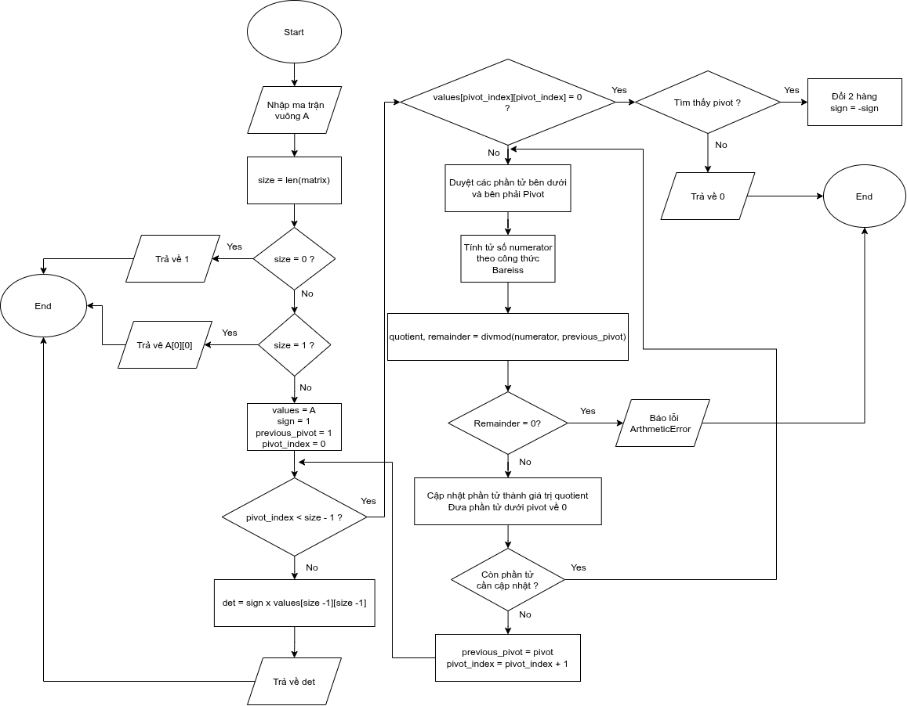

- Còn hàm determinant(matrix) đơn giản là kiểm tra ma trận vuông đầu vào có hợp lệ không rồi gọi hàm \_determinant_unchecked(matrix) để tính định thức
- Lưu đồ thuật toán:  
  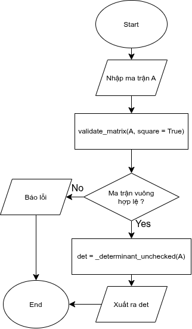

### 4. matrix_inverse_mod(matrix, modulus):

- Hàm matrix_inverse_mod(matrix, modulus) dùng để tìm ma trận nghịch đảo của một ma trận vuông theo modulo m. Ma trận nghịch đảo là ma trận thỏa mãn điều kiện
  

    <strong>AA^-1 = I mod m</strong> 
  

- Không phải toàn bộ ma trận vuông đều tồn tại ma trận nghịch đảo theo modulo m. Một ma trận vuông A muốn tồn tại một ma trận nghịch đảo trên modulo m phải thỏa mãn điều kiện:
  

    <strong>gcd(det(A), m) = 1</strong> 
  

- Thuật toán dựa trên công thức tính ma trận nghịch đảo:
  

    <strong>A^-1 = det(A)^-1 adj(A) (mod m)</strong>  
    Trong đó adj(A) là ma trận phụ hợp chuyển vị
  

- Ma trận con và ma trận phụ hợp:
  - Ma trận con theo hàng i, cột j của ma trận vuông A là ma trận A sau khi bỏ đi hàng i và cột j. Kí hiệu là ma trận Mij
  - Phần bù đại số: Đây là giá trị từng phần tử của ma trận các phần bù đại số. Kí hiệu là ma trận C
    

      <strong>Cij = (-1)^(i+j) det(Mij)</strong>  
    

  - Sau khi có ma trận phần bù đại số là ma trận C[nxn], ta có:
    

      <strong>adj(A) = C^T</strong>  
    

- Lưu đồ thuật toán:  
  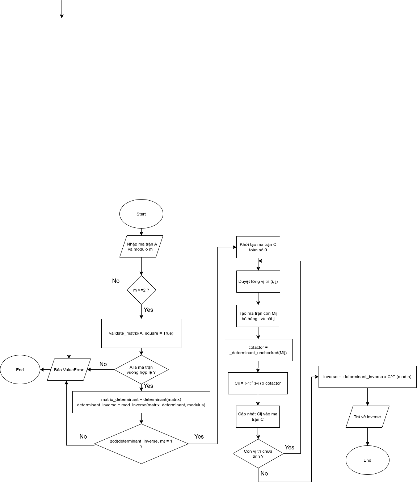

=====================================================================================================

## File permutation.py:

- Đây là file nền tảng toán học về phép chuyển vị, dùng trong mật mã chuyển vị

### 1. Hàm validate_permutation():

- Hàm này dùng để kiểm tra tính hợp lệ của 1 phép chuyển vị. 1 phép chuyển vị chỉ hợp lệ khi nó có đầy đủ các phần tử từ 1 đến n, mỗi phần tử chỉ xuất hiện 1 lần, với n là độ dài của biểu diễn dãy số của phép hoán vị
- Lưu đồ thuật toán:  
  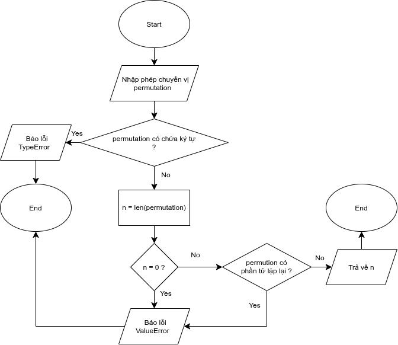

### 2. Hàm inverse_permutation():

- Hàm này dùng để tìm nghịch đảo của một phép hoán vị đầu vào, dùng để giải mã cho mật mã chuyển vị
- Lưu đồ thuật toán:  
  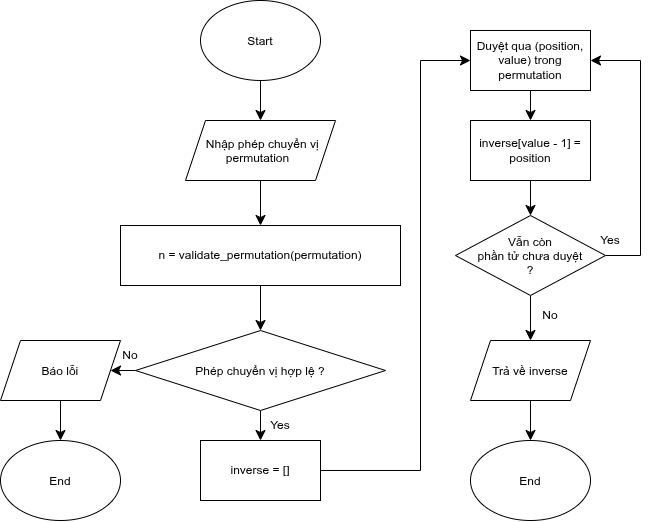
