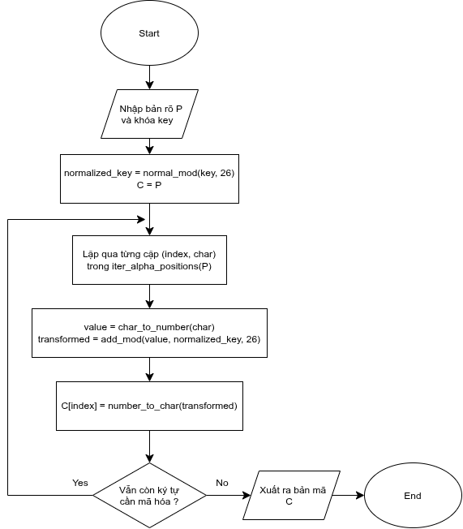
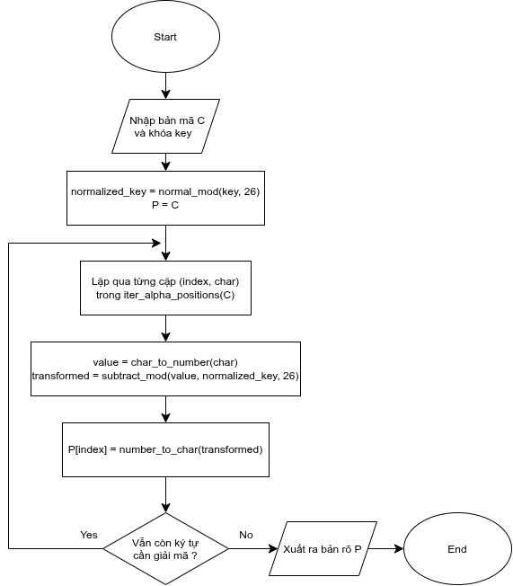
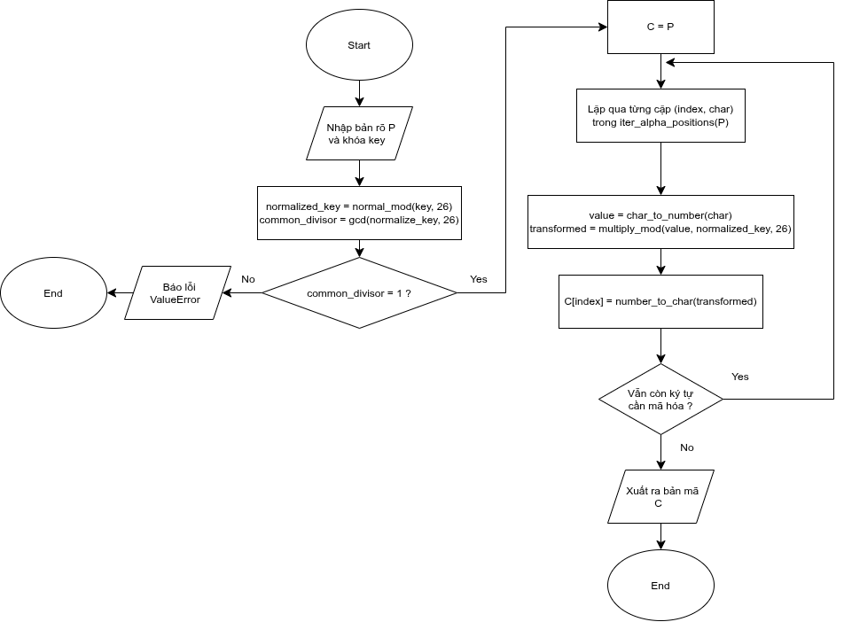
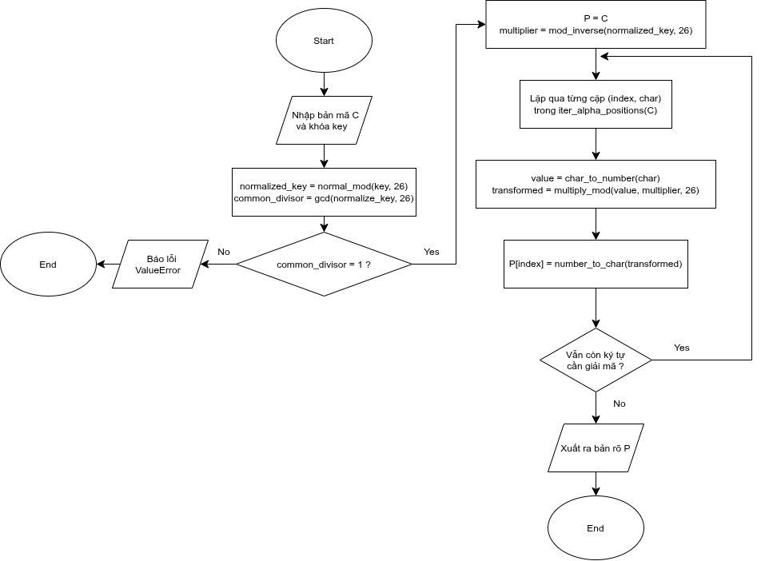
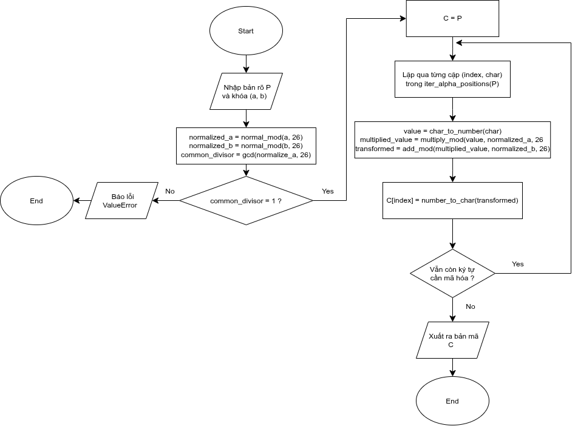
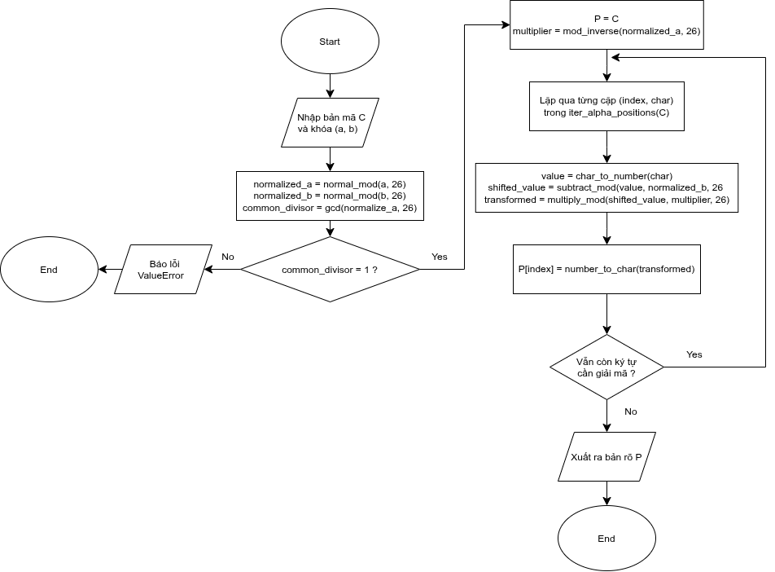

## File classical.common:

- Đây là file quy tắc chung dùng cho mật mã cổ điển. Ở đây nó quy ước:

### 1. Quy ước bảng chữ cái

- Ở đây, ta quy ước là bảng chữ cái tiếng Anh gồm 26 ký tự từ A-Z, mỗi kí tự tương ứng với 1 giá trị nguyên từ 0-25

### 2. Quy ước xử lý văn bản đầu vào

- Ta quy ước chỉ xử lý các ký tự từ A-Z và a-z
- Các ký tự khác như: chữ số, dấu câu, dấu cách và các ký tự khác thì sẽ giữ nguyên

### 3. Quy ước sử dụng khóa số nguyên:

- Ở mật mã shift, multiplicative và Affine, cho phép sử dụng khóa âm hoặc ngoài phạm vi 0-25. Những khóa này sẽ được chuẩn hóa về khoảng 0-25

### 4. Quy ước xử lý khóa chuỗi

- Ở mật mã Vigerene và mật mã Autokey, khóa sử dụng là khóa dạng chuỗi
- Ở đây, chuỗi khóa được quy ước phải theo quy tắc:
  - Chỉ chấp nhận các ký tự ASCII A-Z
  - Có chấp nhận cả chữ hoa và chữ thường, sau đó sẽ chuẩn hóa toàn bộ thành chữ hoa
  - Không chấp nhận khóa rỗng
  - Không chấp nhận khóa có chứa những ký tự ngoài A-Z, kể cả dấu cách, chữ số, dấu câu

### 5. Quy ước xử lý lỗi:

- Sai kiểu dữ liệu: TypeError
- Khóa không hợp lệ: ValueError
- Ma trận không vuông: ValueError
- Ma trận không hả nghịch: ValueError
- Khóa rỗng: ValueError

### 6. Các hàm được xây dựng:

- is_ascii_letter(char)->bool: Kiểm tra kí tự đầu vào có phải từ A-Z không
- char_to_number(char)->int: Chuyển ký tự thành số nguyên tương ứng
- number_to_char(int)->char: Chuyển số nguyên thành ký tự tương ứng
- normalize_alpha_key(str)->str: Kiểm tra và chuẩn hóa khóa
- iter_alpha_positions(str)->iterator: Duyệt các vị trí chứa A-Z, trả về iterator chứa (position, char)
  - Ý nghĩa của hàm này là chỉ trả về vị trí của những ký tự từ A-Z, sau phần mã hóa thì chỉ cần thay đổi những ký tự ở vị trí này, giúp giữ nguyên dấu câu, dấu cách và ký tự nằm ngoài A-Z

## File classical.substitution

- Đây là thuật toán mật mã thay thế gồm 3 loại mật mã là mật mã dịch, mật mã nhân và mật mã Affine

### 1. Mật mã dịch (Shift Cipher):

- Đây là mật mã cổ điển đơn giản nhất
- Ý tưởng của nó là dịch chuyển mỗi ký tự trong bản rõ đi một số vị trí cố định trong bảng chữ cái
- Công thức mã hóa: C = (K+P) mod 26
- Công thức giải mã: P = (C-K) mod 26
- Đối với mật mã dịch, khóa có thể là bất ký số nguyên nào (theo quy ước trên), bởi vì sau khi chuẩn hóa, mỗi khóa đều có một nghịch đảo cộng tương ứng dùng để giải mã
- Lưu đồ thuật toán mã hóa:  
  
   
- Lưu đồ thuật toán giải mã:  
  

### 2. Mật mã nhân (Multiplicative Cipher):

- Mật mã nhân là mật mã thay vì dùng phép cộng modulo thì lại dùng phép nhân modulo
- Cụ thể, mật mã nhân sẽ thực hiện phép nhân giá trị mỗi ký tự với một khóa cố định, rồi sau đó lấy phần dư modulo 26
- Vì mật mã nhân thực hiện phép nhân với khóa, cho nên điều kiện để có thể giải mã là giá trị khóa phải có nghịch đảo nhân hay thuộc tập Z_26\*
- Công thức mã hóa: C = (KP) mod 26
- Công thức giải mã: P = (K^-1 C) mod 26
- Đối với mật mã nhân, điều kiện của khóa là phải có nghịch đảo nhân hay gcd(K,26) = 1

- Lưu đồ thuật toán mã hóa:  
  
   
- Lưu đồ thuật toán giải mã:  
  

### 3. Mật mã Affine (Affine Cipher):

- Mật mã Affine là mật mã kết hợp cả hai loại mật mã: mật mã dịch và mật mã nhân
- Vì thế, mật mã Affine cho ta một miền khóa rộng hơn là một cặp khóa (K1, K2)
- Công thức mã hóa: C = (K1P + K2) mod 26
- Công thức giải mã: P = K^-1(C - K2) mod 26
- Lưu đồ thuật toán mã hóa:  
  
   
- Lưu đồ thuật toán giải mã:  
  

