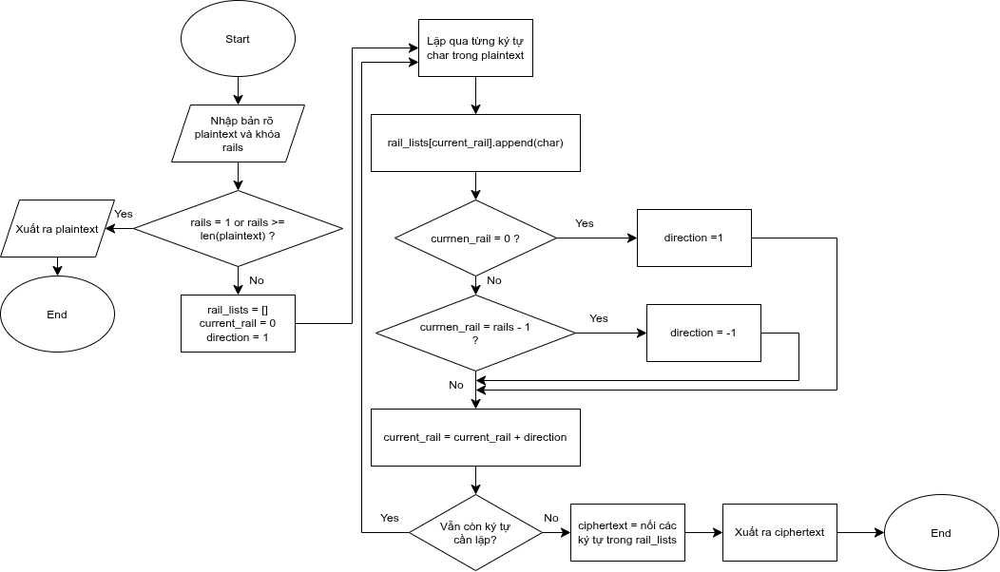
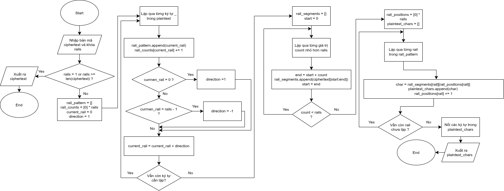
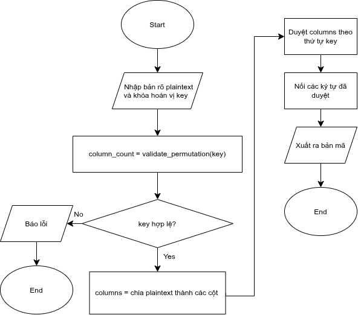
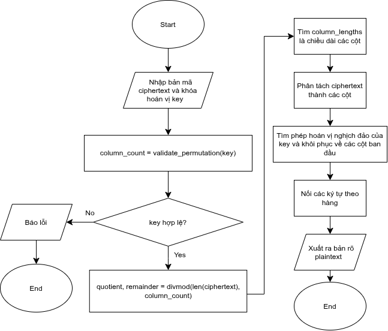

## Mật mã chuyển vị (Transposition Cipher)

- Đối với mật mã thay thế, ta thay thế từng ký tự của bản rõ thành 1 ký tự khác, nhưng vẫn giwũ nguyên vị trí của các ký tự trong bản rõ
- Đối với mật mã chuyển vị, ta không thay thế các ký tự bản rõ thành 1 ký tự khác mà xáo trộn vị trí của các ký tự trong bản rõ
- VD: Với P = CAT
  - Nếu dùng mật mã thay thế là mật mã dịch thì C = DBU, dịch mỗi ký tự thêm 1 trong bảng chữ cái
  - Còn nếu dùng mật mã chuyển vị thì C = TCA, chỉ xáo trộn các ký tự trong P, không thêm hay tạo ra những kí tự khác

## 1. Lý thuyết hoán vị và Nhóm hoán vị (Permutation Theory &amp; Permutation Group)

- Phép hoán vị: Là phép sắp xếp lại thứ tự các vị trí các phần tử của một tập hợp.
- Phép hoán vị $\pi$ là một ánh xạ song ánh, là mô hình toán học định nghĩa mật mã chuyển vị khối độ dài t
- Phép hoán vị nghịch đảo (Inverse Permutation): Đây là phép giải mã $\pi^{-1}$ tương ứng với phép hoán vị $\pi$ sao cho $\pi^{-1}$ $\pi$ = I
- Nhóm hoán vị: Là nhóm tập hợp tất cả các hoán vị t phần tử, có tổng cộng t! phép hoán vị. Khi thực hiện mã hóa chuyển vị nhiều lần liên tiếp, kết quả vẫn sẽ tương đương với thực hiện 1 lần hoán vị duy nhất với t = lcm(t1,t2,t3,...): Bội chung nhỏ nhất
- Phép hoán vị có thể được biểu diễn bằng dãy số: P = [3,2,1,5,4]
- Quy ước: \(Y*i=X*{P_i}\)
- Điều kiện hợp lệ của 1 phép hoán vị: Mỗi phép hoán vị phải có đầy đủ các phần tử từ 1 đến n, mỗi phần tử chỉ xuất hiện 1 lần
- Hoán vị đơn vị (identity permutation): VD P = [1,2,3,4]

## 2. Đại số tuyến tính và ma trận hoán vị (Permutation Matrices)

- Ma trận hoán vị: Khóa chuyển vị kích thước m được biểu diễn thành ma trận vuông khóa K kích thước mxm, trong đó mỗi hàng và mỗi cột có duy nhất 1 giá trị 1, còn lại là giá trị 0
- Mã hóa bằng phép nhân ma trận: C = PK
- Tính chất chuyển vị ma trận ($K^{-1} = K^T$): Để giải mã, ta nhân bản mã với ma trận nghịch đảo của khóa: P = $K^{-1}$ C = $K^T$ C

====================================================================================================

## Mật mã chuyển vị hàng rào (Rail Fence Cipher)

- Mật mã hàng rào là mật mã chuyển vị cổ điển đơn giản, có khóa là một số nguyên k, được gọi là độ sâu (depth)
- Các bước thực hiện mã hóa hàng rào với độ sâu k:
  - B1: Từ bản rõ, bỏ hết khoảng trắng và dấu câu (nếu cần)
  - B2: Viết các ký tự của bản rõ lần lượt từ trái sang phải theo đường zigzag, tổng cộng có k hàng:
    - Đi xuống từng hàng cho đến khi chạm hàng k
    - Sau đó đổi hướng đi ngược lên đến khi chạm hàng đầu tiên
    - Lặp lại quy trình cho đến khi hết chuỗi văn bản
  - B3: Đọc lần lượt các ký tự từ trái qua phải theo từng hàng ngang từ hàng 1 đến hàng k, ghép lại thành bản mã
- VD mã hóa với P = WELCOME TO THE WORLD với k = 4:
  - Xóa khoảng trắng: WELCOMETOTHEWORLD
  - h1:W.....E.....W
  - h2:.E...M.T...E.O
  - h3:..L.O...O.H...R.D
  - h4:...C.....T.....L
  - C = WEWEMTEOLOOHRDCTL
- Các bước thực hiện giải mã hàng rào với độ sâu k:
  - B1: Tạo một bảng có lưới trống k hàng và số cột bằng độ dài bản mã C
  - B2: Đánh dấu đường zigzag (vị trí mà các chữ cái sẽ xuất hiện)
  - B3: Điền lần lượt các ký tự của bản mã vào các vị trí đã đánh dấu theo từng hàng ngang từ trên xuống dưới
  - B4: Đọc các ký tự theo đường zigzag từ trái sang phải để khôi phục bản rõ
- VD giải mã với C = WEWEMTEOLOOHRDCTL, k = 4
  - h1:W.....E.....W
  - h2:.E...M.T...E.O
  - h3:..L.O...O.H...R.D
  - h4:...C.....T.....L
  - P: WELCOMETOTHEWORLD
- Lưu đồ thuật toán mã hóa:  
  
   
- Lưu đồ thuật toán giải mã:  
  

====================================================================================================

## Mật mã chuyển vị cột

- Mật mã chuyển vị cột là mật mã chuyển vị có khóa hoán vị là biểu diễn dãy số cho phép hoán vị
- Mật mã chuyển vị cột có thể có khóa hoặc không khóa
- Khóa hoán vị tiêu chuẩn: K = (3, 2, 6, 1, 5, 4)
- Các bước mã hóa: Với khóa K có m cột
  - B1: Sắp xếp lần lượt các kí tự của bản rõ K vào m cột, từ trái sang phải, từ trên xuống dưới. Nếu hàng cuối thiếu ký tự thì chèn thêm ký tự giả
  - B2: Hoán vị các cột theo quy tắc của khóa K
  - B3: Đọc các ký tự trong bảng đã hoán vị theo từng cột từ trên xuống dưới, ghép thành bản mã
- Thuật toán giải mã:
  - B1: Xác định số cột m của khóa
  - B2: Tìm khóa nghịch đảo
  - B3: Viết các ký tự của bản mã vào theo từng cột từ trên xuống dưới
  - B4: Sắp xếp lại các cột theo quy tắc của khóa nghịch đảo
  - B5: Đọc lần lượt các ký tự theo hàng ngang, ghép thành bản rõ
- VD mã hóa: P = WELCOME TO THE WORLD, K = (3, 2, 6, 1, 5, 4)
  - P = WELCOMETOTHEWORLD
  - h1: W E L C O M
  - h2: E T O T H E
  - h3: W O R L D .
  - Sử dụng khóa K để hoán vị các cột:
    - h1: L E M W O C
    - h2: O T E E H T
    - h3: R O X W D L
  - C = LORETOMEXWEWOHDCTL
- VD giải mã: C = LORETOMEXWEWOHDCTL, K = (3, 2, 6, 1, 5, 4)
  - $K^-1$ = (4, 2, 1, 6, 5, 3)
  - h1: L E M W O C
  - h2: O T E E H T
  - h3: R O X W D L
  - Sử dụng khóa K để hoán vị lại các cột về vị trí ban đầu
    - h1: W E L C O M
    - h2: E T O T H E
    - h3: W O R L D X
  - P = WELCOMETOTHEWORLDX
- Lưu đồ thuật toán mã hóa:  
  
   
- Lưu đồ thuật toán giải mã:  
  
