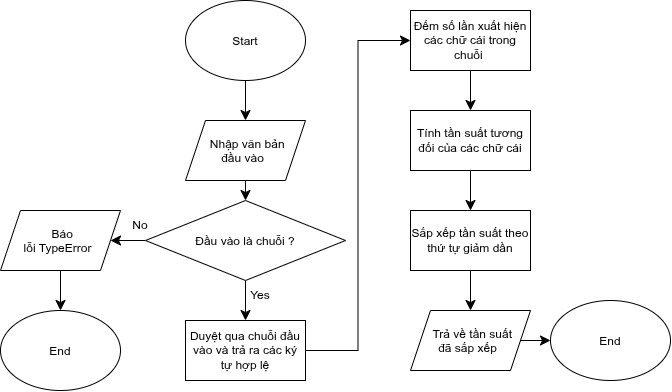
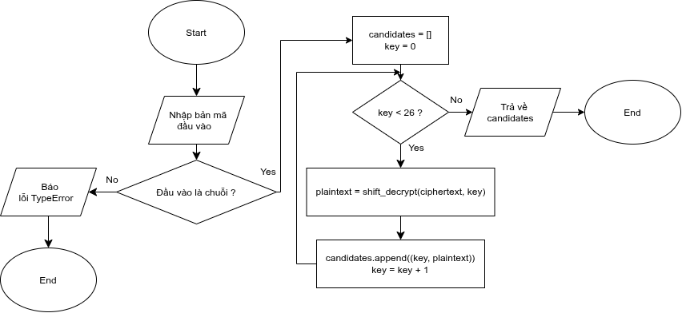
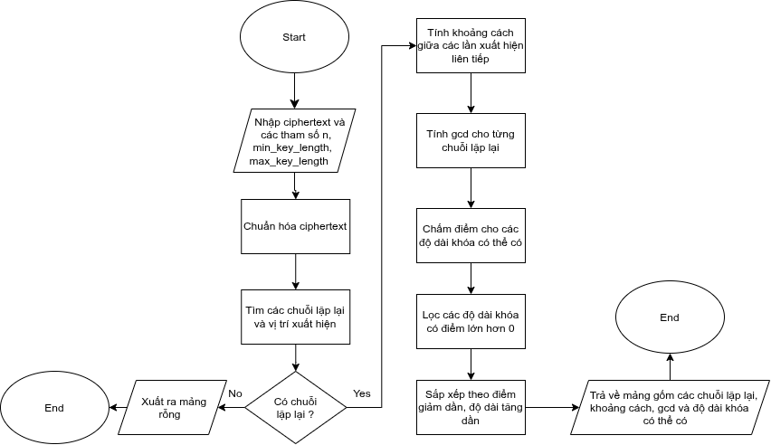

## 4.1 Phân tích tần suất (Frequency analysis)

- Phân tích tần suất (Frequency analysis) là một kỹ thuật thám mã cổ điển, dựa trên việc thống kê số lần xuất hiện của các ký tự trong bản mã hoặc bản rõ
- Phương pháp này khai thác đặc điểm thống kê của ngôn ngữ tự nhiên. Ví dụ như trong tiếng Anh, các chữ cái như E, T, A, O thường xuất hiện nhiều hơn so với J, Q, X, Z

- Bằng cách thống kê và sắp xếp các chữ cái theo tần suất xuất hiện, người phân tích mật mã có thể đưa ra những giả thuyết về ánh xạ giữa chữ cái trong bảng mã và chữ cái trong bản rõ

- Trong phạm vi bài tập lớn, thuật toán sẽ tập trung vào việc:
  - Trích xuất các chữ cái tiếng Anh hợp lệ của từng chữ cái
  - Đếm số lần xuất hiện của từng chữ cái
  - Tính tần suất tương đối của từng chữ cái
  - Sắp xếp các chữ cái theo tần suất giảm dần

### 4.1.1 Cơ sở lý thuyết

- Ta có:

```math
P(c)=\frac{f(c)}{N}
```

- Trong đó:
  - P(c) là tần suất tương đối của chữ cái c
  - N là tổng chữ cái hợp lệ trong văn bản (Các chữ cái từ A-Z)
  - f(c) là số lần xuất hiện của chữ cái c trong văn bản

### 4.1.2. Vai trò của phân tích tần suất trong thám mã

- Phân tích tần suất có thể hỗ trợ phá một số hệ mã cổ điển: như mật mã thay thế đơn bảng chữ cái, mật mã chuyển vị và mật mã đa bảng chữ cái như Vigenere

### 4.1.3. Cài đặt và thiết kế thuật toán


<br>

## 4.2 Tấn công vét cạn (Brute Force Attack):

- Brute Force là phương pháp thám mã bằng cách thử lần lượt tất cả các khóa có thể thuộc không gian khóa của một hệ mật mã, sau đó đánh giá kết quả để tìm ra khóa đúng
- Ví dụ như mật mã dịch có không gian khóa là Z_26
- Ý tưởng:
  - Xác định không gian khóa có thể có
  - Sinh lần lượt từng khóa
  - Sử dụng mỗi khóa để thử giải mã bản mã
  - Đánh giá các bản rõ thu được
  - Đưa ra kết quả có khả năng đúng

### 4.2.1 Xây dựng thuật toán

- Ở trong bài tập lớn này, thuật toán chỉ sử dụng tấn công brute force để giải mã mật mã dịch, hay mật mã Caesar
- Với mật mã Caesar, công thức mã hóa là
  <p align="center">
    C = (P + K) mod 26
  </p>
- Công thức giải mã:
  <p align="center">
    P = (C - K) mod 26
  </p>
- Vì chúng ta chỉ mã hóa các ký tự trong bảng chữ cái tiếng Anh nên không gian khóa có 26 phần tử thuộc Z_26
- Với tấn công brute force, ta sẽ thử lần lượt các khóa trong Z_26 rồi từ đó đánh giá để tìm ra khóa đúng cũng như là bản rõ
- Lưu đồ thuật toán: <br>
   <br>
- Đánh giá độ phức tạp thuật toán:
  - Độ phức tạp thời gian: O(NL)
  - Độ phức tạp không gian: O(NL)
- Trong đó:
  - N là số lượng các phần tử trong không gian khóa
  - L là độ dài các ký tự bản mã

## 4.3. Kasiski Examination (Nhận diện mẫu):

- Kasiski Examination là phương pháp phân tích mật mã Vigenere bằng cách tìm kiếm những chuỗi ký tự lặp lại trong bản mã
- Ý tưởng chính:
  - Tìm các chuỗi ký tự giống nhau xuất hiện nhiều lần trong bản mã
  - Xác định vị trí xuất hiện của những chuỗi đó
  - Tính khoảng cách giữa các lần xuất hiện
  - Phân tích ước chung lớn nhất (GCD) của những khoảng cách
  - Dựa vào đó đưa ra các ứng viên về độ dài khóa Vigenere
- Lý do phương pháp này có hiệu quả là: nếu cùng một chuỗi bản rõ được mã hóa bằng một đoạn khóa, nó có thể tạo ra chuỗi bản mã giống nhau khi vị trí bắt đầu có cùng pha khóa
- Việc tìm GCD không chắc đã là độ dài khóa mà có thể là bội số của độ dài khóa. Vì vậy, Kasiski chỉ đưa ra các ứng cử viên để tiếp tục kiểm tra, không đảm bảo tìm được khóa chính xác ngay lập tức

### 4.3.1 Thiết kế thuật toán

1. Chuẩn hóa bản mã và tìm các chuỗi ký tự lặp lại
2. Ghi nhận vị trí xuất hiện của từng chuỗi lặp lại
3. Tính khoảng cách giữa các lần xuất hiện liên tiếp
4. Tính GCD của các khoảng cách
5. Sử dụng GCD tìm được để xếp hạng các độ dài khóa có thể

- Cách tính khoảng cách giữa hai lần xuất hiện:

```math
d_i=p_{i+1} - p_i
```

- Trong đó:
  - p_i là vị trí xuất hiện thứ i của chuỗi lặp lại
  - d_i là khoảng cách giữa hai lần xuất hiện liên tiếp
- Sau khi đã có các khoảng cách d_i, ta sẽ tìm GCD:

```math
g = gcd(d_1, d_2, ..., d_m)
```

- Từ GCD, ta có thể ước lượng độ dài chuỗi khóa. Mỗi chuỗi lặp lại đóng góp một phiếu cho những độ dài khóa là ước số của GCD tương ứng
- Điều kiện để độ dài khóa k nhận được một phiếu từ GCD:

```math
g \bmod k = 0
```

- Điểm của mỗi ứng viên được tính bằng tổng số phiếu nhận được:

```math
Score(k)=\sum_{i=1}^{M} I(g_i \bmod k=0)
```

- Trong đó:
  - M là số chuỗi lặp lại
  - g_i là GCD của chuỗi lặp lại thứ i
  - I là hàm chỉ thị:
    - I = 1 nếu $g_i ≡ 0 \bmod k$
    - I = 0 nếu $g_i ≡ 0 \bmod k$

- Các ứng viên sẽ được sắp xếp theo thứ tự:
  - Điểm giảm dần
  - Nếu bằng điểm, sẽ sắp xếp theo thứ tự độ dài khóa tăng dần
- Lưu đồ thuật toán: <br>
  
